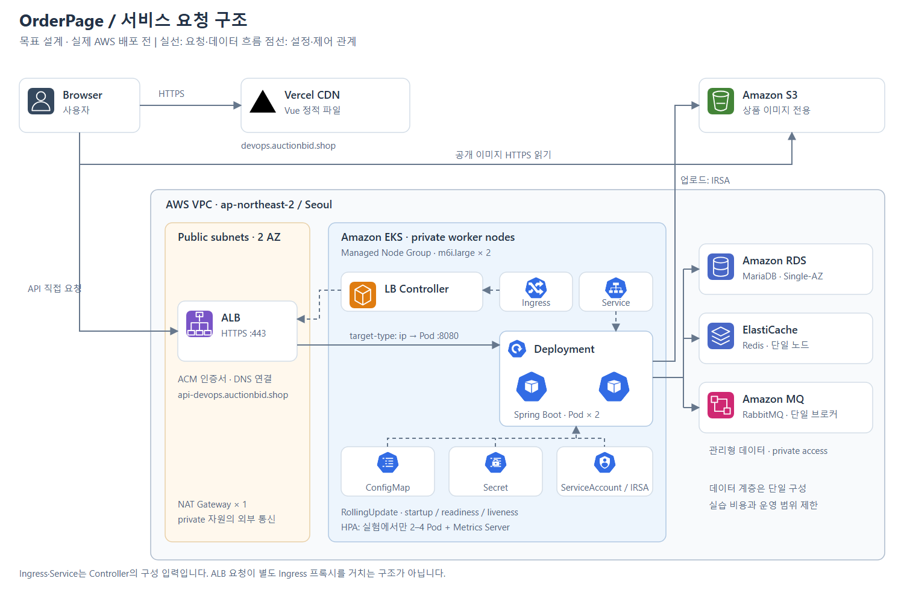
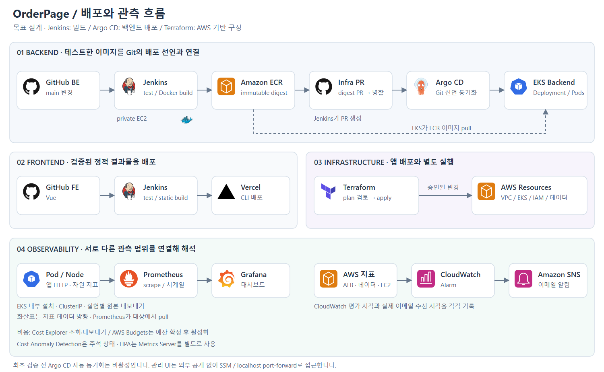

# OrderPage · 배포부터 운영 증거까지

**Terraform으로 AWS EKS 환경을 구성하고, 배포 자동화와 모니터링의 가치를 실험으로 확인하는 DevOps 학습 프로젝트입니다.**

기존 Spring Boot·Vue 주문 서비스를 바탕으로, 인프라를 다시 만들 수 있는지, 서비스 이용 중 버전을 바꿀 수 있는지, 장애를 발견하고 원인을 설명할 수 있는지를 다룹니다. 기술을 설치하는 데서 끝내지 않고 **구성 코드 → 배포 → 관측 → 비교 실험 → 비용 확인과 정리**까지 한 번의 운영 과정으로 남기는 것이 목표입니다.

> **현재: 배포 전 준비 단계 · 2026-11-15 기준**
>
> 기반 코드와 로컬 검증, 보안·비용 재검토는 완료했습니다. 실제 AWS 리소스 생성, 계정에 연결한 Terraform plan, Vercel 배포와 성능 측정은 아직 수행하지 않았습니다. 아래 그림은 **코드로 준비한 목표 구조**입니다.

> **2026-11-16 보안 추가 판단: 공개 배포 보류**
>
> 주문 입력·긴 비밀번호 검증 문제를 로컬에서 재현했고, BE 실행 의존성과 Vercel CLI의 추가 보안 권고를 확인했습니다. 기존 테스트 통과와 공개 배포 가능 여부를 구분합니다. [필수 수정 항목·조건부 허용·재현 근거](docs/restart/predeploy-security-assessment.md)를 먼저 확인하세요.

[구조](#architecture) · [선택 이유](#decisions) · [비교 실험](#experiments) · [진행 상태와 다음 단계](#progress) · [실행 문서](#guide)

## 무엇을 배우고 남기는가

과정명은 **Terraform 기반 EKS 배포와 운영 모니터링**입니다. 애플리케이션 기능 개발보다, 동일한 서비스를 배포하고 운영하는 과정에 집중합니다. 앱 코드는 실제 오류, 보안 문제 또는 운영을 막는 설정에 한해 수정하며, 성능 개선을 목적으로 임의 변경하지 않습니다.

| 학습 과정 | 확인하려는 질문 | 남길 산출물과 기대 가치 |
|---|---|---|
| 인프라를 코드로 구성 | 어떤 자원이 왜 필요한가? 변경·삭제 대상을 실행 전에 설명할 수 있는가? | Terraform 코드, 검토한 plan, 생성·정리 기록. 환경 재현과 변경 검토를 학습합니다. |
| 빌드와 배포 분리 | 테스트한 이미지가 실제 실행되는 이미지와 같은가? 이전 버전으로 돌아갈 수 있는가? | Jenkins 실행 기록, ECR digest, 배포 PR, Argo CD 동기화 이력. 변경의 추적 경로를 만듭니다. |
| 상태를 확인하며 배포 | 새 Pod가 준비되기 전에 요청을 받거나, 기존 요청이 종료 중 끊기지는 않는가? | 배포 중 응답과 Pod 이벤트. 무중단이라는 주장을 실제 결과로 확인합니다. |
| 장애·부하 관측 | 문제가 AWS 자원, Pod, 애플리케이션 중 어디에 있는가? 언제 알림을 받는가? | CloudWatch/SNS 시각, Grafana 화면, Prometheus 원본. 장애 설명과 대응 근거를 남깁니다. |
| 비용까지 포함한 판단 | 개선에 필요한 추가 비용과 운영 부담은 합당한가? | 실험별 비교표, Cost Explorer 비용 기록, 자원 삭제 확인. 성능과 비용을 함께 설명합니다. |

최종 포트폴리오에는 설치 목록보다 **문제 → 선택 근거 → 동일 조건의 비교 → 결과 → 한계**가 드러나도록 기록합니다. 개선율은 실측값이 생긴 뒤 계산합니다.

<a id="architecture"></a>
## 목표 아키텍처

### 서비스 요청은 어디로 가는가



[확대 가능한 SVG](docs/orderpage-devops-architecture.svg) · [그림의 범위와 구성 설명](docs/architecture.md)

브라우저는 Vercel에서 Vue 정적 파일을 받아 실행하고, API는 `api-devops.auctionbid.shop`의 서울 ALB로 직접 요청합니다. **Vercel 서버를 거치는 API 프록시는 두지 않습니다.** 상품 이미지는 별도 S3 버킷에서 읽고, 업로드 권한은 백엔드에만 부여합니다.

AWS Load Balancer Controller는 Ingress·Service 설정을 읽어 ALB와 대상 그룹을 구성합니다. 현재 `target-type: ip` 설정에서는 ALB가 **Pod IP:8080으로 직접 전달**하므로, Ingress를 별도의 프록시 서버처럼 그리지 않았습니다. Deployment는 기본 Pod 2개를 관리하고, ConfigMap·Secret은 환경 설정, ServiceAccount의 IRSA는 AWS 접근 권한을 연결합니다.

### 코드 변경은 어떻게 배포되고 관측되는가



[확대 가능한 SVG](docs/orderpage-delivery-observability.svg)

백엔드는 Jenkins가 테스트·Docker 빌드 후 ECR에 이미지를 올리고, 해당 **digest를 Infra 배포 PR에 기록**합니다. 병합된 선언을 Argo CD가 EKS에 반영합니다. 최초 환경 확인 전에는 Argo CD 자동 동기화가 꺼져 있으며, 승격 절차를 마친 뒤 활성화합니다. 프론트는 Jenkins에서 검증·정적 빌드를 수행하고 Vercel에 배포합니다.

Terraform은 VPC·EKS·데이터 서비스·IAM 등 **AWS 자원**, Argo CD는 **백엔드 Kubernetes 선언**을 담당합니다. Controller·Argo CD·모니터링 도구의 초기 Helm 설치와 Secret 주입은 별도 절차입니다. Terraform 한 번으로 모든 앱과 외부 서비스가 자동 연결되는 구성은 아닙니다.

<a id="decisions"></a>
## 왜 이렇게 구성했는가

### Terraform + EKS: 재현 가능한 환경과 배포 동작을 함께 학습

AWS 콘솔에서 만든 설정을 기억하는 대신, 생성할 자원·의존관계·권한을 코드와 plan으로 검토합니다. EKS는 이번 학습의 필수 조건이며, Deployment·Service·Ingress를 직접 구성해 배포와 트래픽 연결을 이해하는 데 사용합니다. 작은 서비스를 호스팅하는 비용만으로 EKS가 가장 저렴하다고 주장하지 않습니다.

기본은 **고정 Pod 2개 + RollingUpdate + 상태 검사**입니다. Readiness는 요청을 받을 준비, Liveness는 앱 자체의 생존 상태, Startup probe는 초기 기동 시간을 다룹니다. HPA는 기본 운영에 넣지 않고 비교 실험에서만 2~4개로 활성화합니다. Metrics Server가 HPA 판단에 필요한 지표를 제공하며, Node 자동 증설은 구성하지 않았습니다.

### ALB Ingress: 현재 API에 필요한 진입점

HTTPS 종료와 Spring Boot API 라우팅은 ALB로 처리합니다. AWS Load Balancer Controller가 Kubernetes 선언과 ALB 구성을 연결하므로, 별도 NGINX 프록시를 운영하는 계층을 추가하지 않았습니다. NGINX 고유의 라우팅·확장 기능이 필요한 상황은 현재 요구사항에 없습니다.

Gateway API는 라우팅을 표현하는 Kubernetes API이고, AWS API Gateway는 별도의 관리형 서비스입니다. 이 프로젝트에는 Gateway API 도입이나 API Gateway의 별도 API 관리 기능을 검증하는 목표가 없어, 준비된 ALB Ingress 구성을 유지합니다. 어느 기술이 항상 더 빠르거나 저렴하다는 비교 결과는 없습니다.

### Vercel: 프론트 배포 운영 범위를 줄이기 위한 선택

Vue 정적 빌드 결과를 Vercel에 배포해 프론트 호스팅과 HTTPS 제공을 맡깁니다. S3 + CloudFront를 선택했다면 버킷 접근 정책, 배포·캐시 갱신, CDN 설정까지 직접 구성해야 합니다. 이번에는 그 작업보다 **EKS 배포와 운영 관측**에 학습 시간을 배분했습니다. 프론트 호스팅을 Terraform으로 모두 관리하지 않는다는 한계도 있습니다.

이 앱에는 Next.js SSR이나 Vercel Functions가 없습니다. 따라서 “함수 실행 리전을 서울로 바꿔야 브라우저 API 호출이 서울로 간다”는 전제는 적용되지 않습니다. 화면 파일은 Vercel CDN에서 받고, API 경로는 **브라우저 → 서울 ALB**입니다. 실제 지연·전송 비용은 사용자 위치, 캐시, 요청량과 AWS 응답량으로 확인해야 하며, Vercel이 S3 + CloudFront보다 빠르거나 저렴하다고 미리 결론 내리지 않습니다.

### Jenkins + Argo CD: 빌드 결과와 배포 상태의 책임 분리

Jenkins는 테스트와 빌드를, Argo CD는 Git에 선언한 배포 상태와 클러스터의 동기화를 맡습니다. ECR digest와 배포 PR을 연결해 “어떤 소스가 어떤 이미지로 배포됐는가”를 추적합니다. Jenkins가 EKS에 직접 배포하는 방식은 사용하지 않습니다.

Jenkins는 PC와 독립적으로 실행하기 위해 **private EC2**로 선택했습니다. 그만큼 EC2 비용, 플러그인·인증정보·서버 관리 책임이 생깁니다. GitHub Actions와의 제품 간 비교는 별도 환경 없이는 입증할 수 있으므로, 우선 동일 변경의 **수동 배포와 Jenkins + Argo CD 자동화**를 비교합니다.

### CloudWatch와 Prometheus: 관측 범위를 나누고 함께 해석

| 도구 | 이 프로젝트에서 맡는 범위 | 해석할 때의 한계 |
|---|---|---|
| CloudWatch + Amazon SNS | RDS·Redis·MQ·ALB·EC2 상태를 경보로 판단하고 이메일 알림 | SNS 구독 승인이 필요합니다. EC2 상태 검사는 Jenkins 프로세스 생존 검사와 다릅니다. |
| Prometheus + Grafana | Kubernetes의 Pod/Node와 백엔드 HTTP 지표를 수집·조회 | AWS 기본 지표의 대체품이 아닙니다. 내부 접근만 허용하며 현재 PVC 없이 구성했습니다. |
| Cost Explorer | 가동 후 서비스별 비용을 조회·내보내기 | 실시간 차단 장치가 아니며 비용 반영 지연이 있습니다. |
| AWS Budgets / Cost Anomaly Detection | 예산 확정 시 누적 비용 알림 / 향후 비용 이상 탐지 구성 참고 | Budget 기본값은 비활성입니다. Anomaly Detection은 짧은 실습에서 기준 이력이 부족하므로 주석 상태로 유지합니다. |

현재 CloudWatch 범위는 AWS 지표·경보와 설정된 서비스 로그입니다. **전체 앱 로그의 중앙 수집이나 분산 추적까지 완성한 구성은 아닙니다.** Prometheus 원본은 실험마다 내보냅니다. 3일 retention 설정만으로 Pod 재시작 이후의 데이터 보존을 보장할 수는 없습니다.

<a id="experiments"></a>
## 무엇과 비교해 가치를 확인하는가

“이전 환경”은 과거에 운영했다는 가상의 서버가 아닙니다. **같은 AWS 환경 안에서 먼저 실행할 기준 구성**입니다. 기준값을 저장한 뒤 한 가지 조건만 바꿔 개선 구성을 측정합니다. 현재 Terraform 코드는 두 비교군이 공유할 기반이며, 코드가 준비됐다고 기준 측정까지 끝난 것은 아닙니다.

| 실험 | 기준 구성 → 변경 구성 | 측정할 값 | 기대하는 효과 / 확인할 대가 |
|---|---|---|---|
| E01 배포 중 가용성 | Recreate → RollingUpdate, 양쪽 동일 Readiness·기본 2 Pod | 배포 구간 5xx·연결 오류, 가용성, 배포 시간 | 서비스 단절 감소 / 새·기존 Pod가 겹치는 자원과 시간 |
| E02 배포 자동화 | 동일 변경의 수동 배포 → Jenkins + Argo CD | 전체 소요 시간, 사람의 작업 시간, 실패율, 복구 시간 | 반복 작업·누락 감소 / CI 서버와 파이프라인 관리 부담 |
| E03 리소스 설정 | 초기 requests → 실측 근거의 requests | CPU·메모리, Pending/OOM, p95, 처리량 | 과소·과대 설정 개선 / Node 수가 같다면 EC2 비용 절감은 별도 주장 불가 |
| E04 부하 대응 | 고정 2 Pod → HPA 2~4 Pod | p95, 실제 RPS, 5xx, 증설까지 걸린 시간 | 부하 증가 시 응답 유지 / 확장 지연과 고정 Node 용량의 한계 |
| E05 장애 탐지 | 60초 주기 수동 확인 → CloudWatch Alarm + SNS | 장애 시각, 탐지 시각, 이메일 도착, 복구 시각 | 확인 공백 감소 / 평가 주기·전달 지연·오탐 가능성 |

각 실험은 이미지·데이터·Node·요청 시나리오·수집 주기를 고정하고 최소 3회 반복합니다. E01은 같은 이미지 A→B 전환, E02는 같은 변경과 검증 절차를 사용합니다. E05에서도 동일한 장애를 주입하며, SNS 메일 발송 테스트만으로 장애 탐지 검증을 대신하지 않습니다.

**k6는 사용자 관점의 지연·오류**, Prometheus는 서버·Pod 지표, CloudWatch는 ALB와 관리형 자원 상태를 기록합니다. 서로 다른 위치에서 측정한 p95를 같은 값으로 취급하지 않고, 빈 시계열도 정상값 0으로 처리하지 않습니다.

실험 결과는 [비교 실험 절차](docs/restart/experiment-plan-review.md)와 [결과 기록 양식](benchmarks/experiment-report.template.md)에 남깁니다. Jenkins vs GitHub Actions, Vercel vs S3 + CloudFront, CloudWatch vs Prometheus의 제품 간 비교는 현재 실측 범위에 포함하지 않습니다. 구성 이유와 장단점은 설명하되, 실행하지 않은 비교의 개선율은 만들지 않습니다.

## 최대 3일 실습을 위한 비용·보안 경계

VPC는 2개 AZ를 사용하지만 NAT는 1개이고, RDS·Redis·MQ는 단일 구성입니다. Worker는 `m6i.large` 2대, Jenkins는 1대로 준비했습니다. Argo CD·Prometheus·Grafana는 EKS 내부에서 운영하며 관리 UI용 외부 Load Balancer나 관측용 영속 볼륨은 추가하지 않았습니다. **짧은 비교 실험을 위한 절충이며, 데이터 계층까지 고가용성을 보장하는 운영 설계는 아닙니다.**

보관된 2026-11-06/08 서울 단가와 Jenkins 전체 가동 가정으로 계산한 **72시간 기본 항목은 약 $58.41**입니다. 현재 가격 견적이나 지출 상한이 아니며, CloudWatch·알림·로그, 데이터 전송, ALB LCU, ECR/S3 사용량, CPU credit, 세금, Vercel 요금 등은 별도입니다. [계산 근거와 제외 항목](docs/restart/deployment-review.md)을 확인한 뒤 실제 가동 시각과 예산을 정합니다.

실제 인증값·tfvars·state·plan·실험 원본은 Git에서 제외된 경로에 보관합니다. 이미 추적 중인 `.example` 파일을 실제 키로 채우면 그대로 커밋될 수 있고, Terraform의 `sensitive`도 state 저장을 막지는 않습니다. Jenkins는 인스턴스 역할, 백엔드 S3 업로드는 IRSA를 사용해 코드에 AWS 키를 넣지 않습니다. 상품 이미지의 공개 읽기는 전용 버킷에만 허용합니다.

종료 시에는 증거를 먼저 보관하고 Ingress/ALB와 Terraform 자원을 순서대로 정리한 뒤 EBS·EIP·로그·이미지·state 저장소 등 잔여 항목을 확인합니다. **PC나 Pod를 끄는 것으로 AWS 과금이 끝나지 않으며, 예산 알림도 자동 중지 장치가 아닙니다.**

<a id="progress"></a>
## 계획한 과정과 지금의 위치

```text
요구사항·비교군 확정 → 앱 점검 → 인프라·배포·관측 코드 준비
                                           │
                                [현재] 로컬 검증·재검토 완료
                                           ↓
계정·예산·실제 입력 → plan 검토 → AWS 생성·최초 배포
                                           ↓
기준값 측정 → 조건별 비교 → 결과 해석 → 증거 보관·자원 정리
```

| 단계 | 상태 | 완료 기준 또는 남은 확인 |
|---|---|---|
| 요구사항·실험 설계 | 준비 완료 | 필수 기술, 최대 72시간, 5개 비교 시나리오와 측정 양식 정리 |
| 앱·기반·CI/CD·관측 코드 | main 반영 완료 | 코드 및 로컬 검사 완료. 실제 AWS/Jenkins/Vercel 연동과는 구분 |
| 보안·비용 재검토 | 추가 보안 점검에서 수정 필요 | 11/16 재현된 입력·비밀번호 문제 및 의존성/배포 CLI 권고는 공개 배포 전 해결 |
| 계정 연결·실제 plan | 다음 단계 | 유효한 AWS 인증, 운영자 Role/IP, 호환 버전, 보호된 입력, state 저장소 준비 |
| AWS 생성·최초 배포 | 미실행 | ACM/DNS, 관리형 서비스 연결, Jenkins·Argo CD, Secret, 실제 ECR digest, FE·API 확인 |
| 관측 연결·비교 실험 | 미실행 | SNS 수신 확인, Prometheus Targets, 기준값 확보 후 E01~E05 실행 |
| 결과·비용·종료 확인 | 미실행 | 원본과 비교표 보관, 비용 조회, 잔여 자원 확인 |

2026-11-15 재검토에서는 **BE 테스트 23개, FE 테스트 9개·lint·운영 빌드, Infra Node 테스트 36개와 Terraform mock 테스트 22개·validate**를 통과했습니다. 이는 로컬 검증 결과이며 실제 인프라 기동, 운영 성능 또는 완전한 보안 검증을 의미하지 않습니다. FE 개발·빌드 의존성 권고 18건과 전체 BE 의존성 보안 점검 등 남은 범위는 [배포 전 재검토](docs/restart/deployment-review.md)에 공개했습니다.

**바로 다음 작업은 보안 필수 항목 수정입니다.** [보안 판단서](docs/restart/predeploy-security-assessment.md)의 주문 검증 → BE 보안 기반 → Vercel CLI 순서로 처리합니다. 계정·예산·보호된 입력과 plan은 준비할 수 있지만 공개 앱 배포는 필수 항목 해결 후 진행합니다. 이후 [사전 점검](docs/restart/aws-plan-preflight.md)에 따라 plan의 생성·삭제·공개 접근·유료 자원을 검토합니다. 기본 예시의 `enable_jenkins`, `enable_operations_monitoring`과 Argo CD 자동 동기화는 비활성입니다.

<a id="guide"></a>
## 코드를 읽거나 직접 진행하려면

| 저장소 | 책임 |
|---|---|
| [OrderPage_BE_DevOps](https://github.com/leem5514/OrderPage_BE_DevOps) | Spring Boot API, 테스트, Docker 이미지 빌드 대상 |
| [OrderPage_FE_DevOps](https://github.com/leem5514/OrderPage_FE_DevOps) | Vue 화면, 테스트, Vercel 정적 빌드 대상 |
| **이 저장소: Infra** | AWS 자원, Kubernetes 선언, Jenkins 파이프라인, GitOps 배포 상태, 관측과 실험 기록 |

처음 읽는다면 아래 순서대로 진행하면 됩니다. `docs/restart`는 요구사항을 다시 확정한 이후의 기록이며, 문서에 남은 과거 비용 가정보다 최신 [배포 전 재검토](docs/restart/deployment-review.md)를 우선합니다.

| 읽는 순서 | 문서 | 함께 볼 코드 |
|---|---|---|
| 1. 요구사항과 지금까지의 결정 | [전체 진행서](docs/restart/project-process.md) | [Terraform 환경 안내](terraform/envs/dev/README.md) |
| 2. 계정·비용·노출 경계 | [plan 사전 점검](docs/restart/aws-plan-preflight.md), [자격증명 점검](docs/restart/credential-exposure-audit.md) | [remote state](terraform/bootstrap/remote-state), [환경 입력 예시](terraform/envs/dev/terraform.tfvars.example) |
| 3. AWS와 앱 연결 | [기반 구성](docs/restart/terraform-foundation.md), [관리형 데이터](docs/restart/managed-data-services.md), [HTTPS·앱 배포](docs/restart/https-app-deployment.md) | [Terraform modules](terraform/modules), [Kubernetes 기본 선언](k8s/base) |
| 4. 배포 자동화 | [Jenkins·Argo CD](docs/restart/jenkins-argocd.md), [Vercel 배포](docs/restart/frontend-vercel.md) | [Jenkins](jenkins), [Argo CD](argocd), [GitOps](gitops) |
| 5. 관측과 증거 수집 | [CloudWatch·비용](docs/restart/cloudwatch-cost-monitoring.md), [Prometheus·Grafana](docs/restart/prometheus-grafana.md), [비교 실험](docs/restart/experiment-plan-review.md) | [monitoring](monitoring), [benchmarks](benchmarks), [load-test](load-test) |

README는 목적과 현재 상태를 안내하고, 각 실행 문서는 적용 순서·입력값·확인 명령을 다룹니다. 실제 실행 결과가 생기면 배포 시각, 소스/이미지 버전, 실험 원본과 비용 기록을 연결해 갱신합니다.
