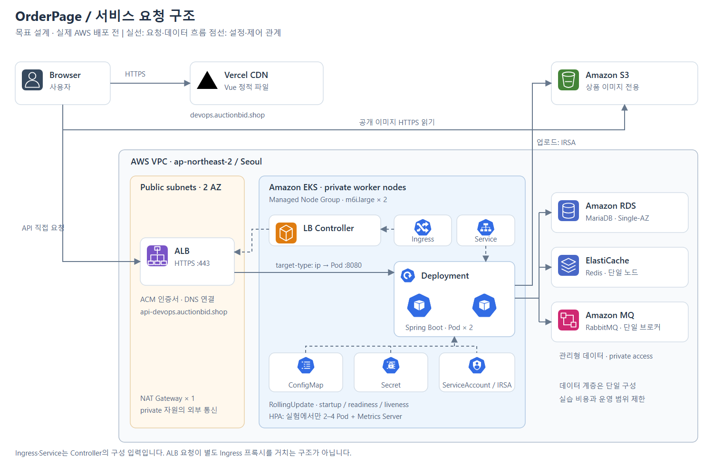
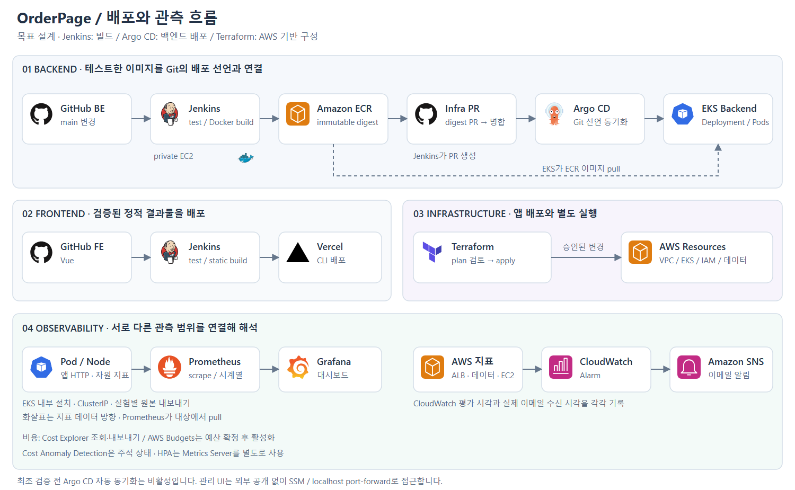

# OrderPage 아키텍처 안내

2026-11-15 코드 기준의 **목표 구조**다. AWS 리소스 생성과 실제 배포는 아직 수행하지 않았다. 프로젝트 목표와 선택 근거는 [README](../README.md), 실행 순서는 [진행서](restart/project-process.md)를 따른다.

## 서비스 요청

[SVG 원본](orderpage-devops-architecture.svg)

브라우저는 Vercel에서 정적 Vue 화면을 받고 서울 ALB에 API를 직접 요청한다. Vercel Functions나 서버 프록시를 경유하지 않는다. AWS Load Balancer Controller는 Ingress와 Service 선언을 읽고 ALB를 구성한다. 현재 IP 대상 설정에서는 실제 요청이 ALB에서 Pod IP:8080으로 전달된다. Service는 대상 발견과 내부 통신에 사용되며, 별도 NGINX Ingress 프록시를 구성하지 않았다.

Deployment는 기본 2 Pod, RollingUpdate와 startup/readiness/liveness probe를 사용한다. ConfigMap은 비밀이 아닌 설정, Secret은 필수 인증값, ServiceAccount의 IRSA는 S3 업로드 권한을 연결한다. HPA는 실험 시에만 2~4 Pod로 활성화하며 Metrics Server가 필요하다. 관리형 데이터는 RDS MariaDB·ElastiCache Redis·Amazon MQ RabbitMQ를 사용한다.

S3는 VPC 내부 서비스로 그리지 않았다. 상품 이미지 읽기는 브라우저에 공개하며 쓰기는 백엔드 IAM 역할에만 허용한다. Terraform state 저장소와 상품 이미지 버킷은 별개다.

**그림의 범위:** 실선은 요청·데이터, 점선은 설정·제어 관계다. VPC는 2개 AZ의 public/private subnet을 사용하며 NAT는 1개다. EKS 영역은 private worker에 배치할 워크로드를 뜻한다. EKS 관리형 control plane, 상세 route table/SG, S3 Gateway endpoint와 state 저장소는 가독성을 위해 생략했다. 데이터 서비스 단일 구성은 고가용성을 보장하지 않는다.

## 배포와 관측

[SVG 원본](orderpage-delivery-observability.svg)

Jenkins가 BE 테스트·Docker 빌드를 수행하고 ECR에 이미지를 저장한다. Jenkins가 해당 digest를 Infra PR에 기록하면 검토·병합 후 Argo CD가 선언을 동기화한다. 그림의 ECR → Infra PR 화살표는 digest 참조이며 ECR이 PR을 생성한다는 의미가 아니다. 이미지 자체는 EKS가 ECR에서 받는다. 최초 검증 전 Argo CD 자동 동기화는 비활성이다.

FE는 Jenkins에서 검증·정적 빌드한 결과를 Vercel CLI로 배포한다. Terraform은 AWS 기반 자원을 담당하며, 앱 배포나 Helm 초기 설치 전체를 대신하지 않는다. Jenkins는 private EC2에서 실행하고 관리 접근에는 SSM을 사용한다. Argo CD·Prometheus·Grafana는 EKS 내부에 설치하며 UI를 외부 Load Balancer로 공개하지 않는다.

관측 화살표는 데이터가 활용되는 방향이다. Prometheus가 앱·Node 지표를 pull하고 Grafana가 이를 조회한다. CloudWatch Alarm → SNS 이메일은 별도의 AWS 운영 알림 경로다. JVM 등 상세 패널, 전체 앱 로그 중앙 수집과 분산 추적까지 완료한 것으로 해석하지 않는다.

| 구체적인 설정 | 실행 문서 |
|---|---|
| ALB/ACM·Secret·상품 이미지 | [HTTPS와 최초 배포](restart/https-app-deployment.md) |
| EC2 Jenkins·ECR·Argo CD | [CI/CD 적용 절차](restart/jenkins-argocd.md) |
| FE 정적 배포 | [Vercel 적용 절차](restart/frontend-vercel.md) |
| AWS 경보·비용·SNS | [CloudWatch와 비용](restart/cloudwatch-cost-monitoring.md) |
| Kubernetes 지표·원본 보관 | [Prometheus와 Grafana](restart/prometheus-grafana.md) |

## 그림 관리와 아이콘

PNG는 README에 표시하는 이미지이며, SVG는 확대·수정할 수 있는 원본이다. SVG는 아이콘을 내부에 포함해 외부 이미지 서버에 의존하지 않는다. 구조를 바꿀 때 SVG와 PNG를 함께 갱신한다.

- Kubernetes: [Kubernetes community icons](https://github.com/kubernetes/community/tree/main/icons), 기존 저장소의 [아이콘 파일](assets/icons/kubernetes)을 사용했다. 해당 프로젝트의 Apache-2.0 / CC-BY-4.0 안내를 따른다.
- GitHub·Jenkins·Docker·Argo CD·Vercel·Terraform·Prometheus·Grafana: [Devicon](https://github.com/devicons/devicon)의 original SVG, [MIT 라이선스 사본](assets/icons/devicon/LICENSE)을 함께 보관했다. 각 브랜드의 상표 권리는 해당 소유자에게 있다.
- AWS 서비스 표시는 이 문서에서 작성한 단순화된 도형이다. 공식 AWS 아키텍처 아이콘으로 표기하지 않으며, 서비스 이름을 함께 명시했다.
